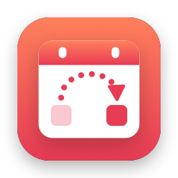
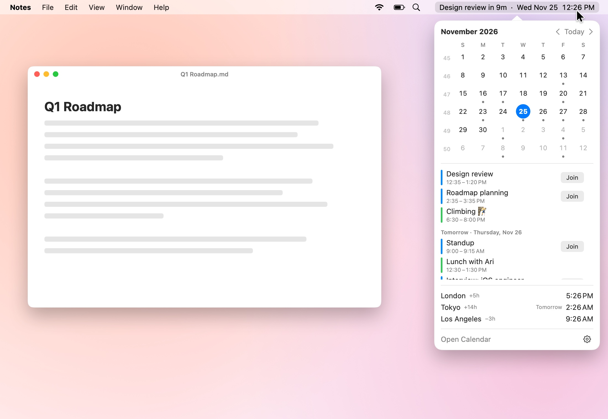
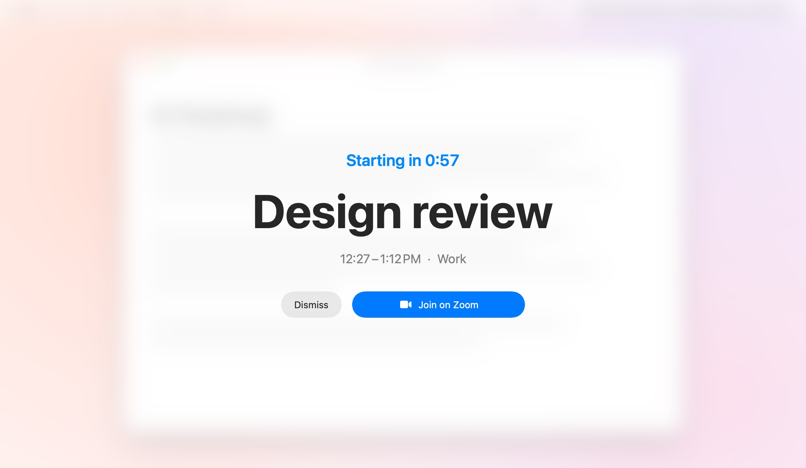
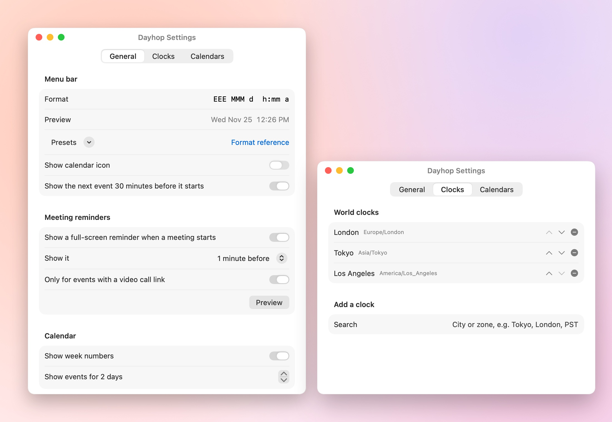

<div align="center">



# Dayhop

**Your day, one click away.**

A tiny, native macOS menu bar calendar. The date and time in your menu bar, your month and upcoming events one click away, a full-screen heads-up when a meeting starts, and clocks for everywhere your team works.

[](https://github.com/eliashussary/dayhop/releases/latest)


[](LICENSE)

<br>

<picture>
  <source media="(prefers-color-scheme: dark)" srcset=".github/assets/hero-dark.jpg">
  
</picture>

</div>

---

## Features

- **Your format in the menu bar.** Any [date format](https://www.unicode.org/reports/tr35/tr35-dates.html#Date_Field_Symbol_Table), with a live preview and presets. Add a calendar icon that shows today's date, or use the icon alone.
- **Month at a glance.** Click the menu bar for the month, with dots on busy days and optional week numbers. Click any day to see what's on.
- **Upcoming events.** Everything in the Calendar app (iCloud, Google, Exchange, anything it syncs), opening on what's next. Declined and canceled events stay out of the way.
- **Full-screen meeting reminders.** When a meeting starts, a glassy overlay covers your screen with a live countdown and a big **Join** button. Press `↩` to join, `esc` to dismiss.
- **One-click join.** Zoom, Google Meet, Teams, Webex, Whereby, Jitsi, Chime and FaceTime links are found in the event's URL, location or notes.
- **Next-meeting countdown.** For the 30 minutes before an event, the menu bar reads `Design review in 9m`.
- **World clocks.** Add a city or an abbreviation (`Tokyo`, `PST`) to see its time, its offset from yours and whether it's already tomorrow there.
- **Native and small.** Written in Swift with AppKit and SwiftUI. It runs as a menu bar app with no Dock icon, and has no network access, analytics or account.

## Install

1. Download the latest **`Dayhop-x.y.z.dmg`** from [Releases](https://github.com/eliashussary/dayhop/releases/latest).
2. Open it and drag **Dayhop** into **Applications**.
3. Open Dayhop, then click **Allow Calendar Access** in its menu bar calendar.

> [!NOTE]
> Releases aren't notarized by Apple yet, so macOS blocks Dayhop the first time you open it. Go to **System Settings → Privacy & Security** and click **Open Anyway**, or run:
>
> ```sh
> xattr -dr com.apple.quarantine /Applications/Dayhop.app
> ```

To uninstall, quit Dayhop from its menu and delete it from Applications.

## Using it

### Calendar

| Do this | To |
| --- | --- |
| Click the menu bar item | Open the calendar |
| Right-click or `⌃`-click it | Open Calendar, Settings, Quit |
| `‹` `Today` `›` | Change month |
| Click a day | See that day's events and the days after it |
| Click an event | Open it in Calendar |
| **Join** | Open the meeting link |

### Meeting reminders

<picture>
  <source media="(prefers-color-scheme: dark)" srcset=".github/assets/reminder-dark.jpg">
  
</picture>

The reminder appears on the screen your pointer is on, over full-screen apps too.

| Key | Action |
| --- | --- |
| `↩` | Join the meeting (or open the event in Calendar if it has no link) |
| `esc` | Dismiss |

In **Settings → General** you can show it when the meeting starts or 1, 2 or 5 minutes before, limit it to events with a video call link (the default), or turn it off. **Preview** shows a sample reminder.

### Settings

<picture>
  <source media="(prefers-color-scheme: dark)" srcset=".github/assets/settings-dark.jpg">
  
</picture>

Open Settings from the gear in the calendar, or by right-clicking the menu bar item.

- **General:** the menu bar format and icon, the next-meeting countdown, meeting reminders, week numbers, how many days of events to list, and launch at login.
- **Clocks:** add, reorder and remove world clocks.
- **Calendars:** choose which calendars to show, such as hiding holidays or birthdays.

Settings are stored in the app's preferences (`defaults read com.eliashussary.dayhop`).

## Building from source

You need macOS 14 or later and the Xcode command line tools (`xcode-select --install`); Xcode itself isn't required.

```sh
git clone https://github.com/eliashussary/dayhop && cd dayhop
make install            # build, copy to /Applications and launch
make check              # self-check for the date, countdown, reminder, time zone and meeting-link logic
make dmg UNIVERSAL=1    # build a universal disk image in build/
```

| Path | What's there |
| --- | --- |
| `Sources/Dayhop/AppDelegate.swift` | Menu bar item, clock tick, popover and menus |
| `Sources/Dayhop/PopoverView.swift` | Month grid, agenda and world clocks |
| `Sources/Dayhop/Reminder.swift` | The full-screen meeting reminder |
| `Sources/Dayhop/Settings.swift` | The Settings window |
| `Sources/Dayhop/Events.swift` | Preferences and Calendar (EventKit) access |
| `Sources/Dayhop/Logic.swift` | Pure date and text helpers covered by `make check` |
| `scripts/make-icon.swift` | Draws the app icon (`make icon`) |
| `scripts/screenshots/` | Renders the README images from the real views with sample events (`make screenshots`) |

## Releasing

Pushing a version tag builds a universal `.dmg` and publishes it to GitHub Releases:

```sh
git tag v0.2.0 && git push origin v0.2.0
```

For signed and notarized builds, add these repository secrets. The release workflow uses them automatically when they're present.

| Secret | Value |
| --- | --- |
| `MACOS_CERTIFICATE` | Base64-encoded Developer ID Application `.p12` |
| `MACOS_CERTIFICATE_PASSWORD` | Password for the `.p12` file |
| `APPLE_ID` | Your Apple ID email |
| `APPLE_TEAM_ID` | Your Apple Developer team ID |
| `APPLE_APP_PASSWORD` | An app-specific password for `notarytool` |

## License

[MIT](LICENSE) © Elias Hussary
